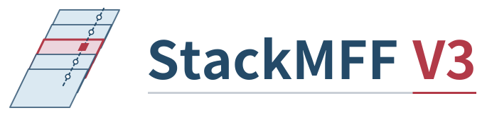
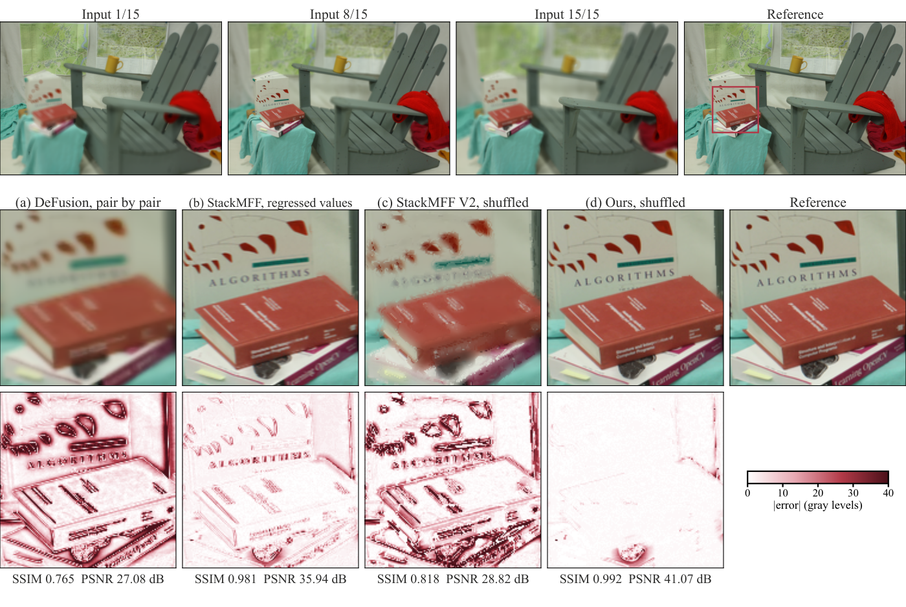
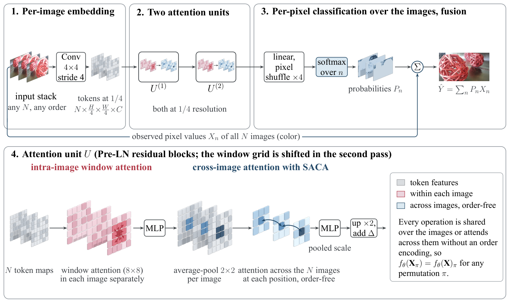
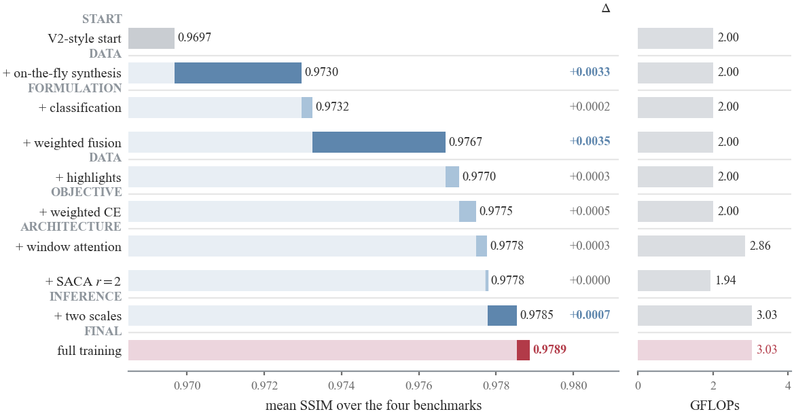

<div align="center">

<picture>
  <source media="(prefers-color-scheme: dark)" srcset="assets/logo_dark.svg">
  
</picture>

**Multi-focus image stack fusion by pixel-wise classification over the input images**

[](#citation)
[](LICENSE)
[](https://www.python.org/)
[](https://pytorch.org/)
[](https://github.com/Xinzhe99/StackMFF-V3/releases/tag/v2.0)
[](https://github.com/Xinzhe99/StackMFF-V3/stargazers)

Official PyTorch implementation of *StackMFF V3: Order-Invariant Focus Stacking via Pixel-Wise Source Classification*.

[Quick start](#quick-start) | [Weights](#pretrained-weights) | [Results](#results) | [Reproducing the paper](#reproducing-the-paper) | [StackMFF series](#related-projects) | [Citation](#citation)

</div>

## News

- **2026.10**: Code, pretrained weights and the evaluation toolkit of StackMFF V3 are released. The manuscript (*StackMFF V3: Order-Invariant Focus Stacking via Pixel-Wise Source Classification*) is being prepared for submission.
- **2026.10**: All **7,262 evaluated benchmark outputs** (including 412 of ours) and **2,170 registered real-stack outputs** are archived with SHA-256 manifests. See the [archive index and downloader](benchmark/README.md). All data assets are in the [v2.0 release](https://github.com/Xinzhe99/StackMFF-V3/releases/tag/v2.0); audited code is versioned separately.
- **Available now**: StackMFF V3 ships inside [OpenFocus](https://github.com/Xinzhe99/OpenFocus) as an AI fusion option. OpenFocus registers the stack, lists StackMFF V3 next to the classical methods, and fuses a whole folder in one batch, so the paper model can be tried without writing any code.
- This repository develops the deterministic fusion formulation of earlier StackMFF V3/V4 studies; historical materials remain in [StackMFF-V3-legacy](https://github.com/Xinzhe99/StackMFF-V3-legacy) and [StackMFF-V4-legacy](https://github.com/Xinzhe99/StackMFF-V4-legacy).

<div align="center">

</div>

*Failure modes of earlier learning-based stack fusion on Middlebury Adirondack (15 images). (a) A pairwise network applied image by image (DeFusion) accumulates blur. (b) Regressing the output intensities (StackMFF) produces values that no image recorded. (c) Regressing a focal index along the ordered stack (StackMFF V2) fails on a shuffled stack. (d) StackMFF V3 selects observed values per pixel; its output is invariant to shuffling up to floating-point error (near-tied hard decisions can differ). Bottom: absolute error with respect to the reference; SSIM / PSNR of the full image.*

## Highlights

- **Fusion as classification.** For every pixel, the network predicts a probability distribution over the N input images. The fused value is the probability-weighted combination of the values observed at that pixel (default) or, with hard selection, the value of the most probable image. The output never leaves the range of the observations.
- **Any number of images, any order.** Cross-image attention has no positional encoding along the image axis, and the remaining image-axis operations are symmetric or shared across images. One trained network handles variable stack lengths, and weighted fusion is order-invariant up to floating-point error; near-tied hard decisions can differ.
- **Small and fast.** 0.156 M parameters; 3.03 GFLOPs for two 256x256 images with the default two-scale inference (1.94 GFLOPs with one scale); 0.16 s per Mobile Depth stack (12 to 33 images) on an RTX A6000.
- **Training data and loss.** Stacks are synthesized on the fly at the training resolution from all-in-focus images with depth (including saturated highlights), and a contrast-weighted cross-entropy concentrates the training signal on pixels where the choice of the image changes the fused value.
- **Re-evaluated benchmark.** Weighted fusion has the highest mean SSIM and PSNR on Mobile Depth, Middlebury and FlyingThings3D; hard selection leads on Road-MF. The Mobile Depth PSNR margin over GFF is not statistically significant after correction.

## Method

<div align="center">

</div>

Each image of the stack is embedded separately into tokens at 1/4 resolution (4x4 convolution with stride 4). Two attention units with separate weights follow; each unit alternates **intra-image window attention** (8x8 windows, shifted in the second pass) with **cross-image attention**, in which the N tokens at the same position attend to each other after 2x2 spatial aggregation (SACA). A linear layer and a pixel shuffle give one logit map per image at full resolution; the softmax over the images gives the probabilities P_n, which weight the observed pixel values X_n. Colour stacks are processed on their luma (BT.601), and the same probabilities are applied to the three colour channels. At inference, the probabilities are averaged over the input at full and 0.75 scale and smoothed with a Gaussian of 0.5 pixel before the weighted sum.

<details>
<summary>Formulations of the StackMFF series and the step-by-step roadmap (click to expand)</summary>

<div align="center">

</div>

*From StackMFF to this work: (a) StackMFF regresses the fused intensities with a 3D network; (b) StackMFF V2 regresses a continuous focal index along the ordered stack and samples source pixels at the rounded index; (c) StackMFF V3 classifies for every pixel which image is in focus and combines the observed values with the predicted probabilities. All maps are actual outputs on the Mobile Depth "balls" scene.*

<div align="center">

</div>

*Mean SSIM over the four benchmarks along the roadmap from a StackMFF V2-style network to the final model, one cumulative change per row, with the cost of each configuration (GFLOPs for two 256x256 images). Blue: a gain above the seed variation of the short training protocol; light blue: a change within it; red: full training of the final model. Displayed Δ values subtract adjacent four-decimal means; bar lengths use unrounded scores.*

</details>

## Results

The model fuses variable-length focal stacks and, at 0.16 M parameters, runs one
Mobile Depth stack in 0.10 s. It leads three of the four benchmark families on
reference SSIM and both read-outs stay at the top of the source-based metrics;
the complete per-scene numbers, statistics and tables are in
[`benchmark/`](benchmark/README.md).

| Where | What it contains |
|---|---|
| [`benchmark/current/TABLES.md`](benchmark/current/TABLES.md) | all 37 configurations on the four stack benchmarks |
| [`benchmark/current/per_image.csv`](benchmark/current/per_image.csv) | one row per method and scene, with the metric vector |
| [`benchmark/current/stats.md`](benchmark/current/stats.md) | paired Wilcoxon with Holm correction, Friedman ranks, Nemenyi intervals |
| [`benchmark/pair_extension/RESULTS.md`](benchmark/pair_extension/RESULTS.md) | the 863-pair two-input experiment, eight source metrics and PSNR/SSIM |
| [v2.0 data release](https://github.com/Xinzhe99/StackMFF-V3/releases/tag/v2.0) | every released output image and the checkpoint |

## Installation

```bash
git clone https://github.com/Xinzhe99/StackMFF-V3.git
cd StackMFF-V3
conda create -n stackmffv3 python=3.10 -y && conda activate stackmffv3
pip install -r requirements.txt          # inference only: pip install torch numpy opencv-python
```

Install PyTorch for your CUDA version from [pytorch.org](https://pytorch.org/get-started/locally/) if the default wheel does not match. Training used Python 3.8, PyTorch 2.1.2 and CUDA 12.1; `fuse.py` was also tested with PyTorch 2.14.1 on the CPU (`requirements.txt` lists all tested versions).

## Quick start

Fuse one stack (a folder with the images of one scene, registered, in any order):

```bash
python fuse.py --input path/to/stack --output fused.png            # probability-weighted fusion (default)
python fuse.py --input path/to/stack --output fused_hard.png --hard # hard selection: one source pixel per output pixel
```

The weights are downloaded to `weights/stackmff_v3_final.pth` on first use. `fuse.py` runs on the GPU when one is available and on the CPU otherwise.

| Option | Default | Meaning |
|---|---|---|
| `--input` | | folder of one stack, or a list of image files (2 or more; 8-bit or 16-bit; colour or grey) |
| `--output` | | fused image (PNG/TIFF keep 16-bit input) |
| `--hard` | off | hard selection (argmax) instead of the weighted fusion |
| `--weights` | `weights/stackmff_v3_final.pth` | checkpoint |
| `--device` | `auto` | `cpu`, `cuda`, `cuda:1`, ... |
| `--sigma` | `0.5` | Gaussian smoothing (pixels) of weighted-fusion probabilities; ignored by `--hard` |
| `--scales` | `1,0.75` | input scales whose probabilities are averaged (`1`: one pass, about 40% faster) |
| `--index_map` | | also save the index of the most probable image per pixel (0-based, natural order of the file names) |
| `--threads` | PyTorch default | CPU threads |

A stack must use one dtype throughout (all 8-bit or all 16-bit); grayscale inputs are loaded into three channels, and the saved fusion is three-channel. Images of a different size are resized to the first image; the stack must be registered (for hand-held bursts, align the images first, for example with [OpenFocus](https://github.com/Xinzhe99/OpenFocus)). To fuse many stacks at once, use `tools/run_ours_roots.py` (see below).

In Python (pass `scales=(1, 0.75)` explicitly to `load_checkpoint` to fix the paper configuration; an explicit `scales` argument takes precedence over `MS_SCALES`, whose value is read when the module is imported):

```python
import torch
from fuse import read_stack, probabilities, fuse
from stackmff_v3.model_io import load_checkpoint

model = load_checkpoint('weights/stackmff_v3_final.pth', 'cuda' if torch.cuda.is_available() else 'cpu', scales=(1, 0.75))
imgs = read_stack(['img_01.png', 'img_02.png', 'img_03.png'])        # list of HxWx3 BGR arrays (OpenCV)
P = probabilities(model, imgs, next(model.parameters()).device, sigma=0.5)   # [N, H, W], sums to 1 over N
fused = fuse(P, imgs, hard=False)                                     # HxWx3, same dtype as the input

# Hard selection uses the same checkpoint/scales and unsmoothed probabilities.
P_hard = probabilities(model, imgs, next(model.parameters()).device, sigma=0)
fused_hard = fuse(P_hard, imgs, hard=True)
```

## Pretrained weights

| File | Description | Size | SHA-256 |
|---|---|---|---|
| [stackmff_v3_final.pth](https://github.com/Xinzhe99/StackMFF-V3/releases/download/v2.0/stackmff_v3_final.pth) | final model of the paper (EMA weights after the third of six epochs); architecture arguments included | 0.66 MB | `39b2ea3738e8fea1676c379238d6be81a87988fc9952dbd6ac3825d5d7249f46` |

The checkpoint is a dictionary `{'model': state_dict, 'args': architecture}` (fp32, no optimizer state) and is loaded with `stackmff_v3.model_io.load_checkpoint`. Running `fuse.py` with these weights reproduces the reported configuration. Floating-point differences can affect a few rounded weighted values or change hard selection at near-tied probabilities; the archived outputs are the canonical inputs for recomputing the reported metrics.

## Reproducing the paper

### 1. Data

**Benchmarks** (testing only): Mobile Depth, Middlebury, FlyingThings3D and Road-MF as distributed with [StackMFF V2](https://github.com/Xinzhe99/StackMFF-V2#-downloads), organized as

```
benchmarks/
  Mobile Depth/   image stack/<scene>/<images>   AiF/<scene>.png
  Middlebury/     image stack/<scene>/...        AiF/...
  FlyingThings3D/ image stack/<scene>/...        AiF/...
  Road-MF/        image stack/<scene>/...        AiF/...
```

**Training sources**: NYU Depth V2, DUTS, DIODE, Cityscapes and ADE20K, prepared with the `make_datasets` scripts of [StackMFF V2](https://github.com/Xinzhe99/StackMFF-V2) (depth from Depth Anything V2 except for NYU Depth V2). Layout:

```
stackmffv3_training_datasets/<NYU-V2|DUTS|DIODE|Cityscapes|ADE>/<TR|TE>/
  AiF/<name>.<ext>          all-in-focus image
  depth/<name>.png          8-bit depth map
  focus_stack/<name>/       pre-synthesized stack (used for validation)
  focus_index_gt/<name>.npy its focus-index map
```

Build the two caches used by `train.py`:

```bash
python tools/make_cache_aif.py --data_root /path/to/stackmffv3_training_datasets --out data/cache_aif320 --workers 24   # (AiF, depth) pairs, 320x320
python tools/make_cache.py --data_root /path/to/stackmffv3_training_datasets --size 256 --out data/cache256 --workers 48 # validation stacks, 256x256
```

### 2. Training

```bash
DATA=/path/to/stackmffv3_training_datasets CACHE=data/cache256 PAIRS=data/cache_aif320 BENCH=/path/to/benchmarks \
RUN=runs/final bash scripts/train_final.sh
```

This is the command of the reported run (two GPUs, batch 8 per GPU, 6 epochs, about 14 min per epoch on two RTX A6000); the defaults of `train.py` are the same. Every epoch, `train.py` writes the EMA weights to `runs/final/model_save/epoch_<k>.pth`, validates on the held-out synthetic stacks and monitors the four benchmarks (`bench_log.csv`). Options that are off by default were tried during development and are not used by the final model.

### 3. Fused results

```bash
RUN=runs/final BENCH=/path/to/benchmarks OUT=results bash scripts/eval_final.sh
```

evaluates every epoch, selects the one with the best mean SSIM of the weighted fusion and writes the colour results of that epoch (`results/final_soft`, `results/final_hard`). The results of the released weights are produced with

```bash
python tools/run_ours_roots.py --root /path/to/benchmarks --out results/Ours_soft                 # weighted fusion, sigma 0.5
python tools/run_ours_roots.py --root /path/to/benchmarks --out results/Ours_hard --fusion hard   # hard selection
```

`tools/run_ours_roots.py` fuses any folder tree `<root>/<dataset>/image stack/<scene>/` and was also used for the robustness variants (shuffled, incomplete and redundant stacks) and the real-data experiments. The fused images of our model (weighted and hard selection) on all four benchmarks are released as `stack_outputs_ours.tar` (412 PNGs) in the [v2.0 release](https://github.com/Xinzhe99/StackMFF-V3/releases/tag/v2.0); the full-reference and no-reference scores for these outputs can be recomputed with `evaluation/run_eval.py`. The [archive index](benchmark/archives.json) covers every released image, including all 206 ZMFF outputs, and `release_index.json` in the release names each archive with its SHA-256 and image count.

### 4. Evaluation

`evaluation/` computes the primary reference-based and stack-based metrics in the paper: SSIM (Gaussian 11x11 and 7x7), PSNR, VIF, MI, NMI against the reference, and Q<sup>AB/F</sup> and MEF-SSIM against the source stack, with optional homography alignment for results that are cropped or rescaled. All metrics were cross-checked against the reference MATLAB implementations (`evaluation/xval/`, `evaluation/validate.py`). To evaluate a folder of results `<results>/<method>/<dataset>/<scene>.png`:

```bash
python evaluation/run_eval.py run --gt_root /path/to/benchmarks --gt_subdir AiF --stack_root /path/to/benchmarks \
    --results_root results --methods Ours_soft Ours_hard --out_dir eval_out --workers 6
python evaluation/run_eval.py summarize --gt_root /path/to/benchmarks --gt_subdir AiF --stack_root /path/to/benchmarks \
    --results_root results --methods Ours_soft Ours_hard --out_dir eval_out
python evaluation/stats.py --dir eval_out --ref Ours_soft      # Friedman / Nemenyi / Wilcoxon-Holm (needs >= 3 methods)
```

`run` caches one JSON file per method and scene (restartable); `summarize` writes `per_image.csv`, `summary.csv`, `summary.md` and `alignment_log.md`. The same options can be given in a JSON file (`--config`, see `evaluation/config_example.json`), which also maps methods stored in other folders (`overrides`) and lists methods that are always aligned (`aligned_methods`; Helicon Focus in the paper). Scene names are matched ignoring case, extension and punctuation.

### 5. Two-input fusion extension

The 863-pair experiment on Lytro, MFFW2, MFI-WHU and Real-MFF uses a separate
toolkit in [`benchmark/pair_extension/`](benchmark/pair_extension/README.md):
eight source-based metrics (MATLAB, with a toolbox-free Linux path) and
reference PSNR/SSIM, plus the aggregation and table generators. The frozen
protocol, per-pair manifest and metric provenance are included there, and every
per-image record binds input, implementation and output hashes. Results and the
typeset tables are in
[`benchmark/updates/2026-10-20-pair-extension/`](benchmark/updates/2026-10-20-pair-extension/README.md).

### 6. Efficiency and other tools

| Script | Purpose |
|---|---|
| `tools/count_cost.py` | parameters and GFLOPs (0.156 M; 1.94 / 3.03 GFLOPs for two 256x256 images) |
| `tools/time_final.py` | inference time with the protocol of the efficiency table (GPU) |
| `tools/time_vs_n.py` | time and memory versus the number of images (GPU) |
| `tools/eval_epochs.py` | per-epoch benchmark evaluation and colour results of the selected epoch |
| `tools/eval_ablation.py` | per-epoch evaluation of ablation runs |
| `tools/eval_smooth.py` | effect of the smoothing sigma |
| `tools/save_conf.py`, `tools/save_probs_crop.py` | probability and confidence maps for the figures |
| `predict_benchmark.py` | hard selection on grey images (the monitoring protocol of `train.py`) |
| `tests/test_network.py` | shapes, permutation equivariance (float32 and float64), order invariance, parameter count |

## Repository layout

```
fuse.py                   fuse one stack (entry point)
train.py                  training (single GPU or DDP); defaults = final model
synth.py                  on-the-fly synthesis of training stacks on the GPU, contrast weight of the loss
predict_benchmark.py      benchmark monitoring (hard selection, grey)
stackmff_v3/
  network.py              StackMFFLoop (final model: single_scale=True, linear head) and the earlier StackMFFV3 variant
  model_io.py             final configuration, checkpoint loading
  Dataloader.py           pre-synthesized stacks (validation)
scripts/                  train_final.sh, eval_final.sh
tools/                    data caches, evaluation of epochs and ablations, cost and timing, figure data
evaluation/               evaluation toolkit (metrics, runner, statistics, MATLAB/Octave cross-validation)
tests/                    unit tests
assets/                   logo and figures
```

`stackmff_v3/network.py` also contains the components that were evaluated in the ablations and are not part of the final model (second resolution, full-resolution image branch in the head, convolutional intra-image block, image-index embedding, regression head); they are off by default.

## Related projects

StackMFF V3 is part of the **StackMFF series** on multi-focus image stack fusion ([overview](https://github.com/Xinzhe99/StackMFF-Series)):

| Project | Description |
|---|---|
| [StackMFF](https://github.com/Xinzhe99/StackMFF) | end-to-end stack fusion network that regresses the fused image with 3D convolutions (Applied Intelligence, 2025) |
| [StackMFF V2](https://github.com/Xinzhe99/StackMFF-V2) | one-shot stack fusion via focal depth regression (Engineering Applications of Artificial Intelligence, 2025); test datasets and benchmark results |
| **StackMFF V3** (this repository) | pixel-wise classification over the input images with intra- and cross-image attention |
| [OpenFocus](https://github.com/Xinzhe99/OpenFocus) | free, open-source focus stacking software for Windows and macOS with a command-line interface: image registration, classical and learned fusion methods, batch processing of stack folders. StackMFF V3 is included as an AI fusion option that can be tried directly. |

If this work or any project of the series is useful to you, please consider giving a star to the [StackMFF series](https://github.com/Xinzhe99/StackMFF-Series) and to [OpenFocus](https://github.com/Xinzhe99/OpenFocus). It helps us a lot, thank you.

## Citation

The entry below will be updated with the final bibliographic data once the paper is published.

```bibtex
@article{xie2026stackmffv3,
  title   = {StackMFF V3: Order-Invariant Focus Stacking via Pixel-Wise Source Classification},
  author  = {Xie, Xinzhe and Guo, Buyu and Li, Bolin and He, Shuangyan and Gu, Yanzhen and Jiang, Qingyan and Li, Peiliang},
  note    = {Manuscript in preparation},
  year    = {2026}
}
```

Earlier work of the series:

```bibtex
@article{xie2025stackmff,
  title     = {StackMFF: end-to-end multi-focus image stack fusion network},
  author    = {Xie, Xinzhe and Jiang, Qingyan and Chen, Dong and Guo, Buyu and Li, Peiliang and Zhou, Sangjun},
  journal   = {Applied Intelligence},
  volume    = {55},
  number    = {6},
  pages     = {503},
  year      = {2025},
  publisher = {Springer}
}

@article{xie2025stackmffv2,
  title     = {One-shot multi-focus image stack fusion via focal depth regression},
  author    = {Xie, Xinzhe and Guo, Buyu and He, Shuangyan and Gu, Yanzhen and Li, Yanjun and Li, Peiliang},
  journal   = {Engineering Applications of Artificial Intelligence},
  volume    = {162},
  pages     = {112667},
  year      = {2025},
  publisher = {Elsevier}
}
```

## License

Our code is released under the [MIT License](LICENSE). Benchmark images, fused outputs and third-party components retain the rights and conditions of their underlying sources; they are not relicensed as MIT. See [third-party notices](THIRD_PARTY_NOTICES.md).

## Acknowledgements

- Training sources: [NYU Depth V2](https://cs.nyu.edu/~fergus/datasets/nyu_depth_v2.html), [DUTS](http://saliencydetection.net/duts/), [DIODE](https://diode-dataset.org/), [Cityscapes](https://www.cityscapes-dataset.com/) and [ADE20K](https://groups.csail.mit.edu/vision/datasets/ADE20K/); depth maps estimated with [Depth Anything V2](https://github.com/DepthAnything/Depth-Anything-V2).
- Benchmarks: Mobile Depth (Suwajanakorn et al., CVPR 2015), Middlebury (Scharstein et al., GCPR 2014), FlyingThings3D (Mayer et al., CVPR 2016) and Road-MF, in the focal-stack versions of the StackMFF V2 benchmark.
- The intra-image window attention follows [Swin Transformer](https://github.com/microsoft/Swin-Transformer). The baselines were run with the official code and weights of their authors; the metrics follow the reference implementations credited in `evaluation/metrics_lib.py`.
- The wordmark of the logo uses glyph outlines of Noto Sans (SIL Open Font License 1.1).
